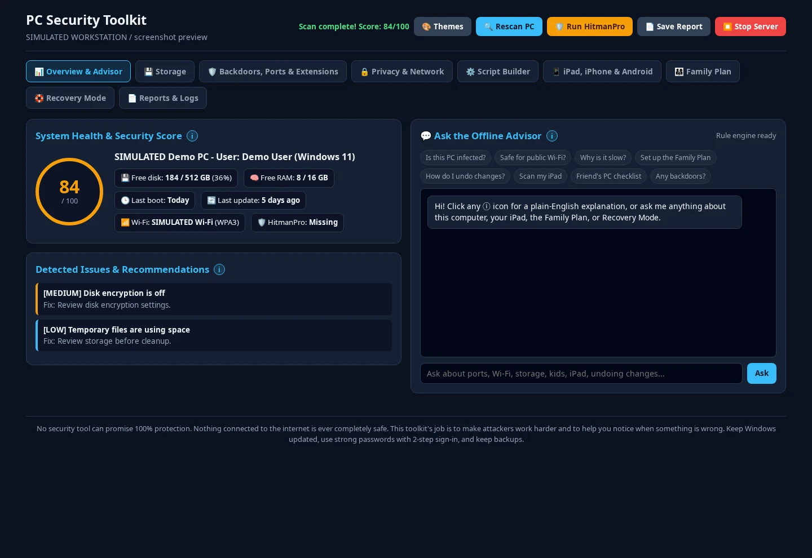
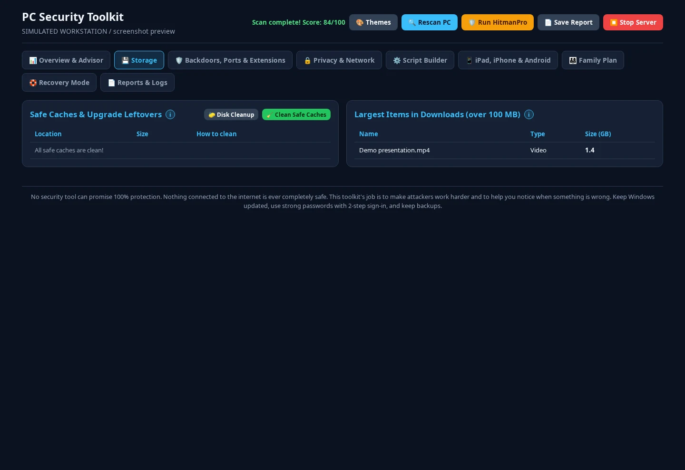
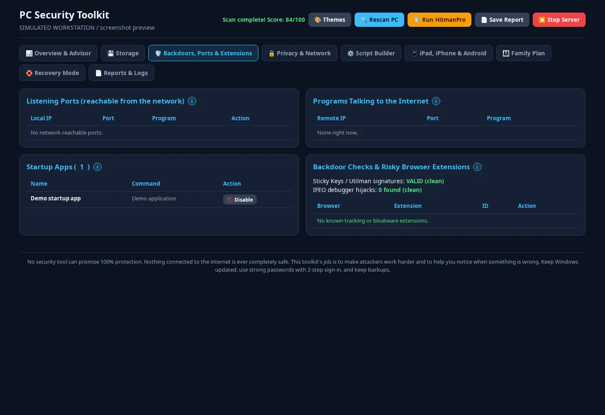
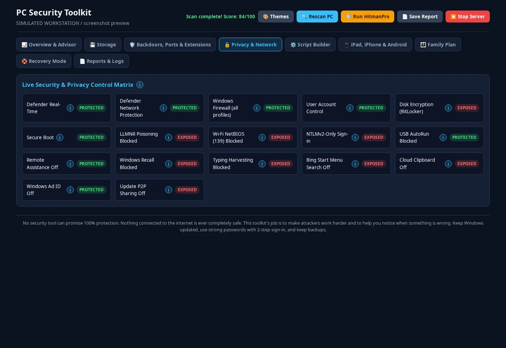
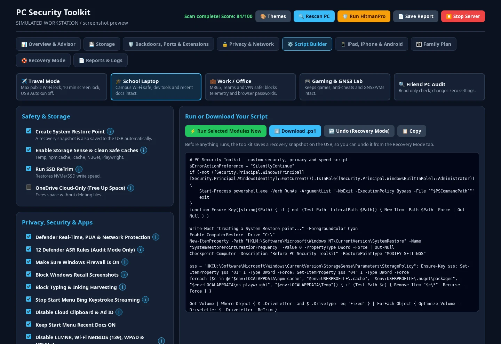
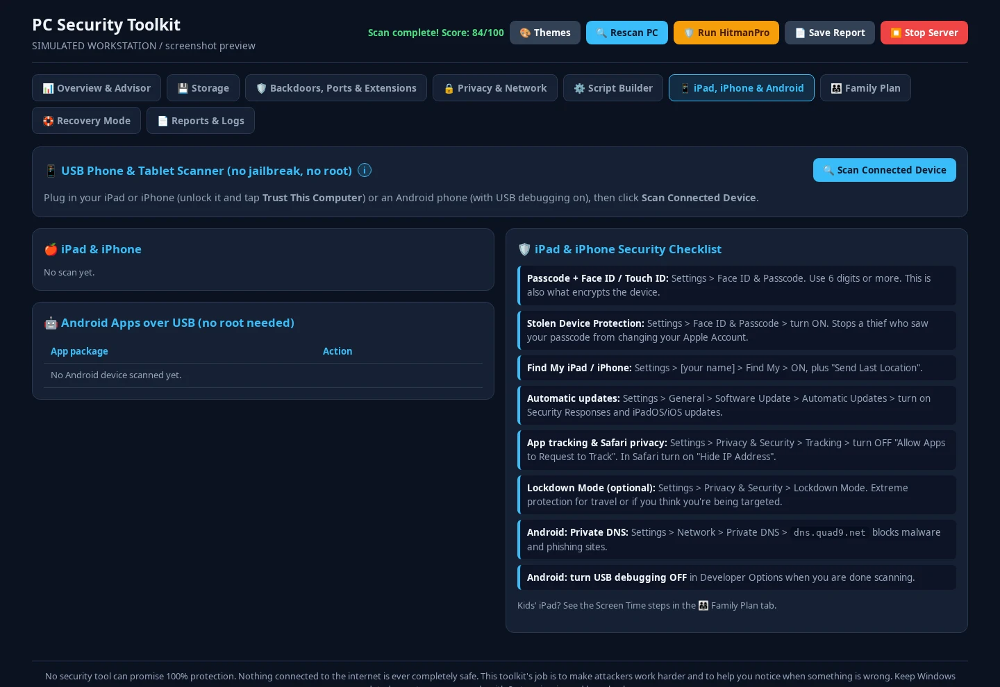
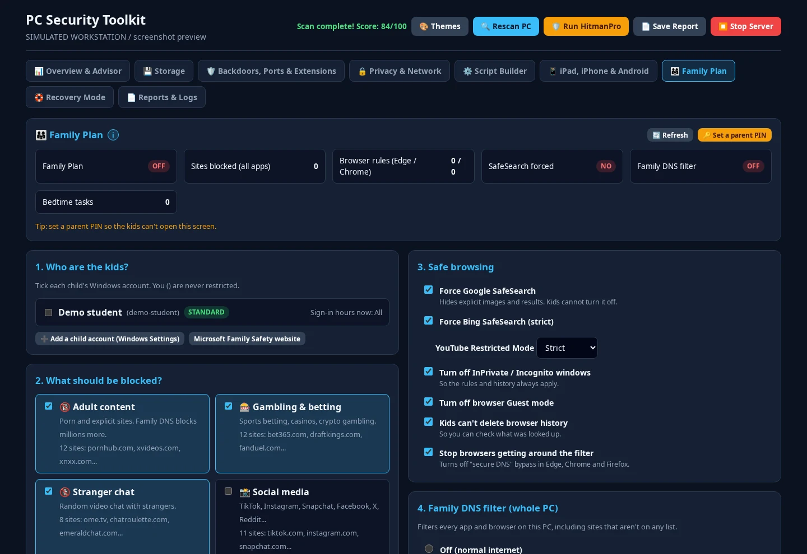
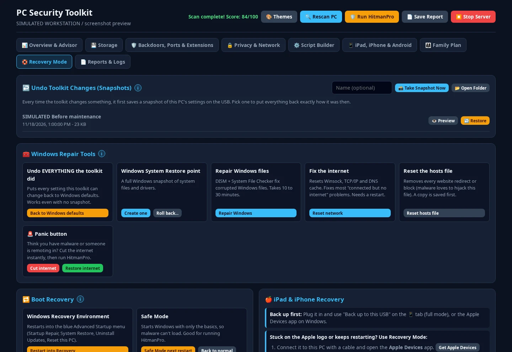
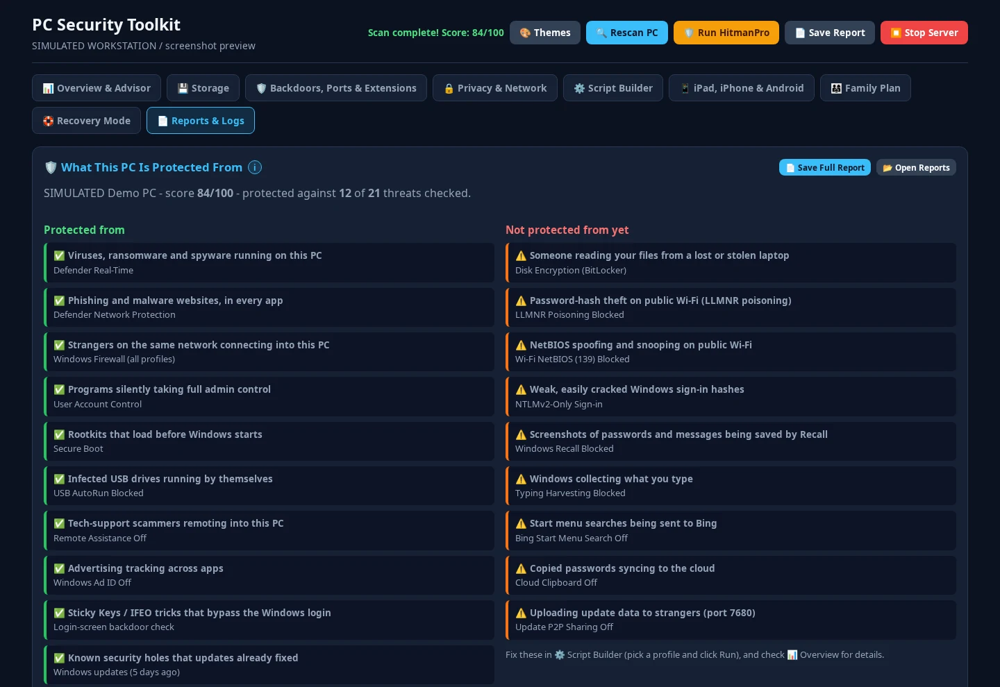

# PC Security Toolkit screenshots

Captured from the toolkit dashboard using a simulated Windows workstation. Scan results, file names, accounts, and recovery snapshots are sample data. No system changes were applied.

Select an image to open it at full size.

| Overview and security advisor | Storage review |
| --- | --- |
|  |  |

| Ports, startup items, and extensions | Privacy and network controls |
| --- | --- |
|  |  |

| Windows profile and script builder | iPad, iPhone, and Android tools |
| --- | --- |
|  |  |

| Family Plan controls | Recovery tools and sample snapshot |
| --- | --- |
|  |  |

| Protection report and logs |  |
| --- | --- |
|  |  |
